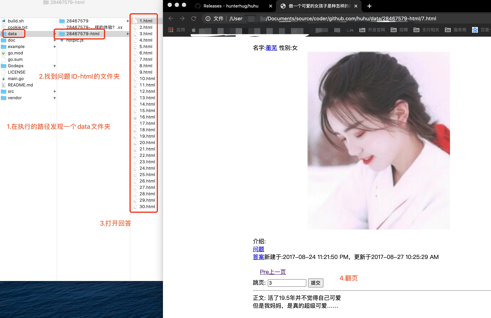

# 项目：huhu

太久没用，知乎改规则了～

[](https://github.com/hunterhug/huhu/network)
[](https://github.com/hunterhug/huhu/stargazers)
[](https://github.com/hunterhug/huhu)
[](https://goreportcard.com/report/github.com/hunterhug/huhu)
[](https://github.com/hunterhug/huhu/issues)
[](https://raw.githubusercontent.com/hunterhug/huhu/master/LICENSE)

这是一个获取某乎回答的 `Tool/SDK` ， 可以获取单个问题， 单个收藏夹， 单个人下面的回答， 支持下载图片， 生成HTML离线查看。

目前接口由Golang开发， 实现的API功能可以供外部程序员使用(持续修正)：

1. 通过单个问题id获取批量答案， 可保存图片和HTML回答
2. 通过集合id获取批量问题后获取批量答案， 可保存图片和HTML回答
3. 根据用户唯一域名id获取其关注的人，和关注她的人
4. 获取一个人的所有回答
5. 图片获取使用并发模式， 速度极快
6. 关注别人（风险大容易被封杀，建议不要使用）~~
7. 通过答案id获取单个回答（有点鸡肋，还是写了）~~

## 一.小白使用

工具下载请前往 [释出版本二进制](https://github.com/hunterhug/huhu/releases) 下载最新的二进制，然后运行二进制。

 Windows 可以单击 `zhihu_windows_amd64.exe` 。

一般交互模式(问答式)
 
```
go run main.go

        -----------------
        知乎问题信息小助手

        支持:
        1. 从收藏夹 https://www.zhihu.com/collection/78172986 批量获取很多问题答案
        2. 从问题 https://www.zhihu.com/question/28853910 批量获取一个问题很多答案

        请您按提示操作（Enter）！答案保存在 data 文件夹下，例如打开 28467579-html/1.html ！

        如果什么都没抓到请往 exe 同级目录 cookie.txt 增加 cookie。

        联系：https://github.com/hunterhug/huhu
        -----------------
        
萌萌：你有几种选项, 你的决定命运着图片链接是否被替换?

        选项:
        1. X(默认): 下载回答的同时图片会下载到电脑里，可以永久观看
        2. Y: 下载回答，但不下载图片，图片还是在知乎的服务器上
        3. Z: 将所有问题集合起来，当前目录下生成一个 index.html

        请选择(可以直接回车):
```

结束后请打开 `data` 文件夹：



如果你觉得项目帮助到你，欢迎请我喝杯咖啡

微信:


# LICENSE

欢迎加功能( `PR/issues` )，请遵循 `Apache License` 协议.

```
Copyright 2017 by huhu author.
Licensed under the Apache License， Version 2.0 (the "License");
you may not use this file except in compliance with the License.
You may obtain a copy of the License at
    http://www.apache.org/licenses/LICENSE-2.0
Unless required by applicable law or agreed to in writing， software
distributed under the License is distributed on an "AS IS" BASIS，
WITHOUT WARRANTIES OR CONDITIONS OF ANY KIND， either express or implied.
See the License for the specific language governing permissions and
limitations under the License
```
